<!-- 全局占位符：将 {SITE_URL} 替换为正式站点地址 -->
# 船舶监造系统--论文

本商品为「船舶监造系统--论文」，基于 SpringBoot 技术栈开发。

## 👉 完整项目 / 演示录屏 / 更多项目：{SITE_URL}

## ✨ 功能清单

- 个人中心：管理员可以管理个人信息，包括修改密码、查看个人信息等。
- 管理员管理：管理员可以管理其他管理员账号，包括添加、删除、编辑管理员账号等操作。
- 基础数据管理：管理员可以管理系统的基础数据。
- 公告管理：管理员可以管理系统发布的公告信息，包括添加、删除、编辑等操作。
- 项目管理：管理员可以管理船舶监造项目。
- 开工准备：管理员可以管理船舶监造项目的开工准备情况。
- 项目图纸管理：管理员可以管理项目相关的图纸文件。
- 监造过程验收：管理员可以进行监造过程的验收。
- 质量管理：管理员可以进行质量检查和管理，包括记录问题、制定改进计划等。
- 用户管理：管理员可以管理普通用户账号，包括查看用户列表、禁用用户等操作。
- 个人中心：员工可以管理个人信息，包括修改密码、查看个人信息等。
- 公告管理：员工可以查看系统发布的公告信息。
- 项目管理：员工可以查看被分配的船舶监造项目。
- 开工准备：员工可以参与船舶监造项目的开工准备工作。
- 项目图纸管理：员工可以查看和下载项目相关的图纸文件。
- 监造过程验收：员工可以参与监造过程的验收工作。
- 质量管理：员工可以记录发现的质量问题，并参与改进计划的执行。
- 个人中心：用户可以管理个人信息，包括修改密码、查看个人信息等。
- 公告管理：用户可以查看系统发布的公告信息。
- 项目管理：用户可以查看自己参与的船舶监造项目。

## 🛠 技术栈

- spring-boot-starter-parent: 2.2.2.RELEASE
- java.version: 1.8
- org.springframework.boot:spring-boot-starter-web
- mybatis-spring-boot-starter: 2.1.1
- org.springframework.boot:spring-boot-starter-jdbc
- org.springframework.boot:spring-boot-starter-thymeleaf
- org.springframework.boot:spring-boot-devtools
- mysql:mysql-connector-java
- shiro-spring: 1.3.2
- mybatis-plus: 2.3
- mybatisplus-spring-boot-starter: 1.0.5
- protobuf-java: 3.10.0
- commons-lang3: 3.0
- validation-api: 2.0.1.Final
- commons-io: 2.5
- hutool-all: 4.0.12
- fastjson: ${fastjson.version}

## 📁 目录结构

```
chuan-bo-jian-zao-xi-tong-springboot/
├── db/
│   └── db.sql
├── docs/
│   ├── DESENSITIZE.md
│   └── REVIEW.md
├── src/
│   └── main/
├── 运行截图/
│   ├── 1.png
│   ├── 10.png
│   ├── 11.png
│   ├── 12.png
│   ├── 13.png
│   ├── 2.png
│   ├── 3.png
│   ├── 4.png
│   ├── 5.png
│   ├── 6.png
│   ├── 7.png
│   ├── 8.png
│   └── 9.png
├── pom.xml
└── 运行必读.txt
```

## 🚀 快速开始

### 环境要求
- JDK 1.8+（以 `pom.xml` 为准）
- Maven 3.x
- MySQL 5.7+ / 8.x

### 步骤
1. 克隆本仓库
2. 用 IDE 打开项目根目录（含 `pom.xml` / `package.json`）
3. 导入 `db/` 或根目录下的 `*.sql` 到 MySQL
4. 修改 `src/main/resources/application.yml`（或 `.properties`）中的数据库账号密码
5. 启动主启动类（`*Application.java`）或执行 `mvn spring-boot:run`
6. 浏览器访问 `http://localhost:8080`

### 端口
- `8080`

### 账号
- 1. 个人中心：管理员可以管理个人信息，包括修改密码、查看个人信息等。
- 2. 管理员管理：管理员可以管理其他管理员账号，包括添加、删除、编辑管理员账号等操作。
- 10. 用户管理：管理员可以管理普通用户账号，包括查看用户列表、禁用用户等操作。
- 1. 个人中心：员工可以管理个人信息，包括修改密码、查看个人信息等。
- 1. 个人中心：用户可以管理个人信息，包括修改密码、查看个人信息等。
- http://localhost:8080/chuanbo/admin/dist/index.html
- 管理员				账户:admin 		密码：admin
- 用户				账户:a1 		密码：123456
- 用户				账户:a2 		密码：123456
- 用户				账户:a3 		密码：123456
- 员工				账户:a1 		密码：123456
- 员工				账户:a2 		密码：123456

## 📸 截图

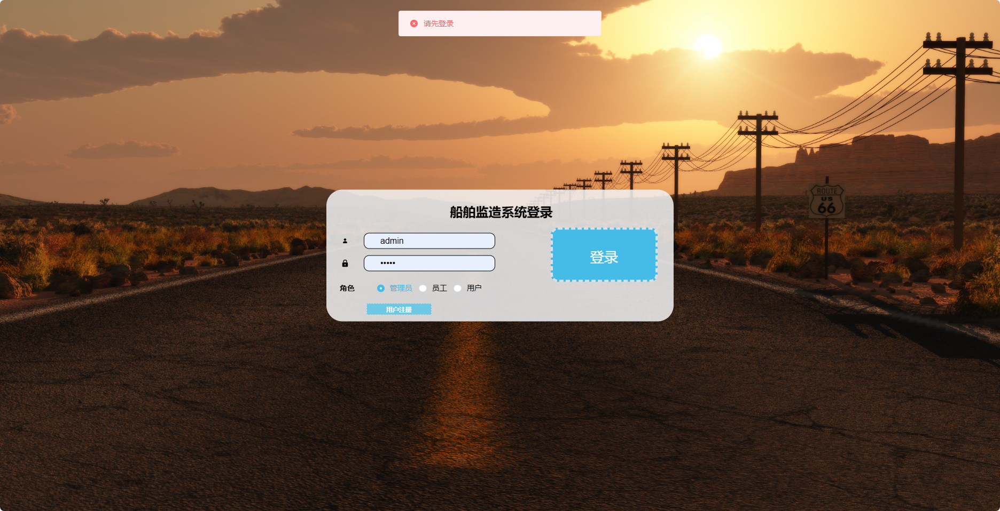
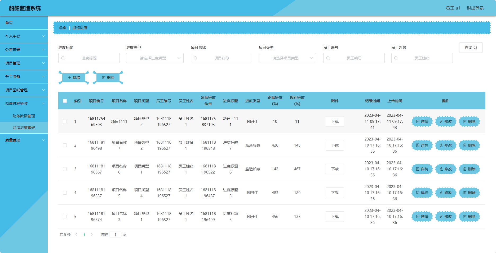
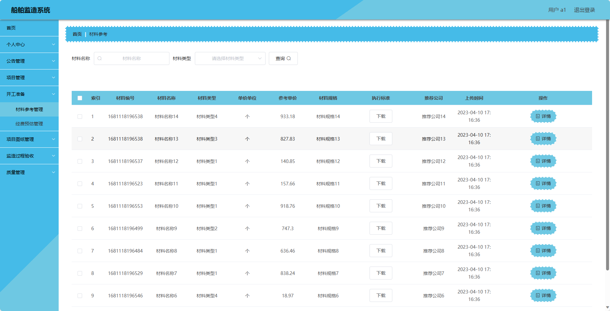
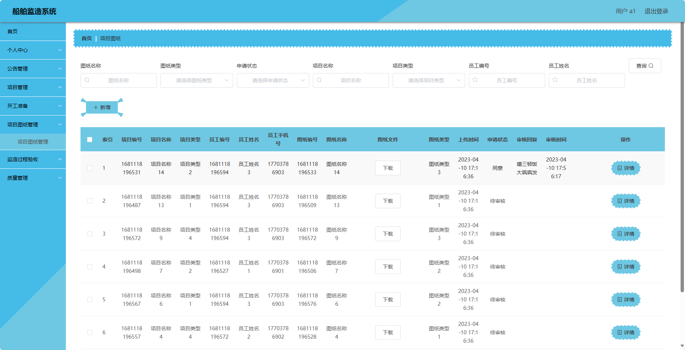
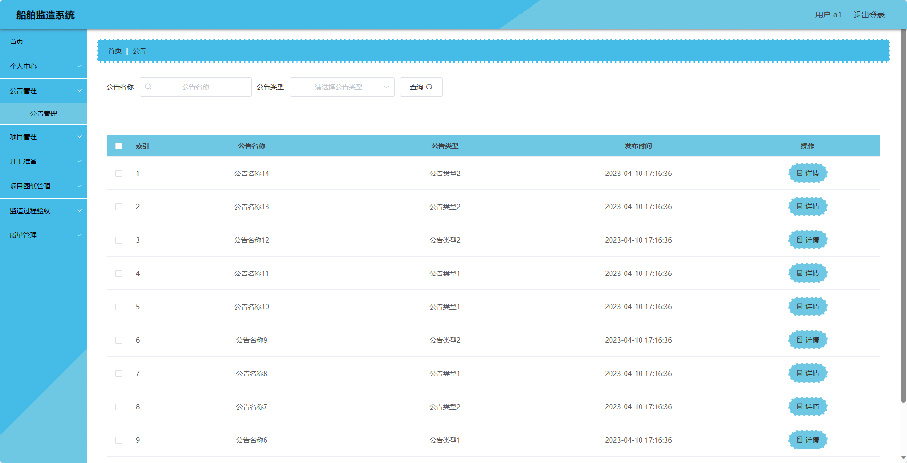
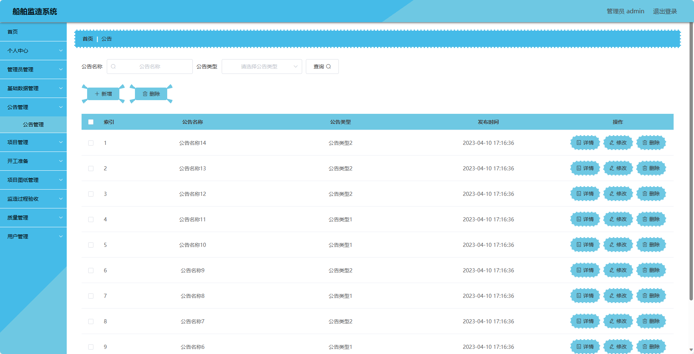
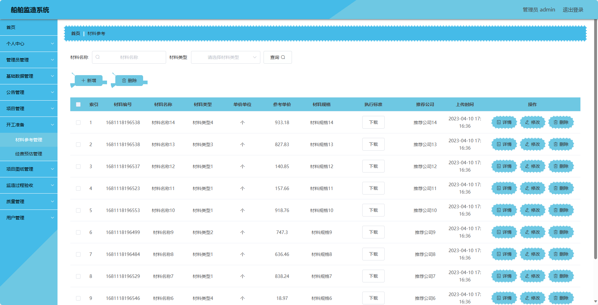
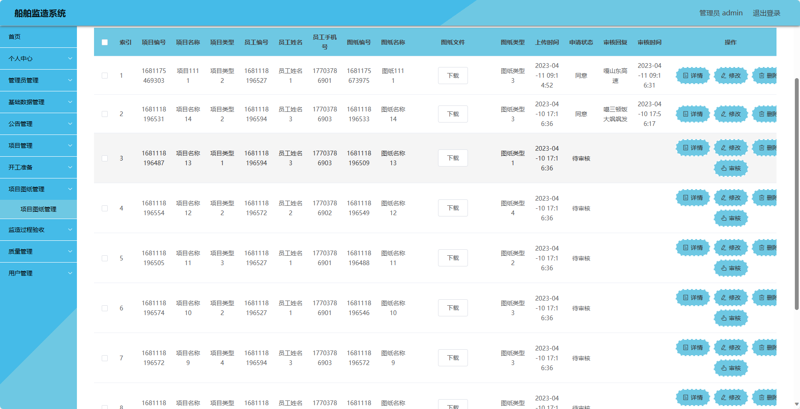
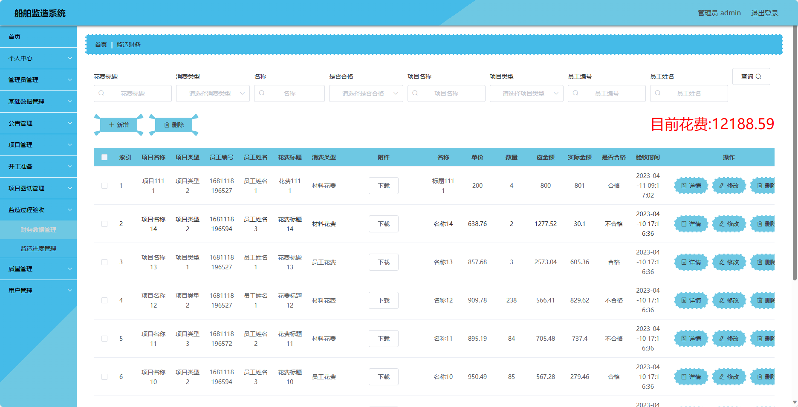
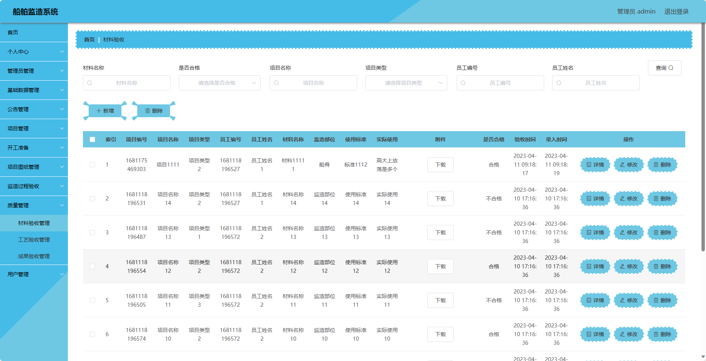
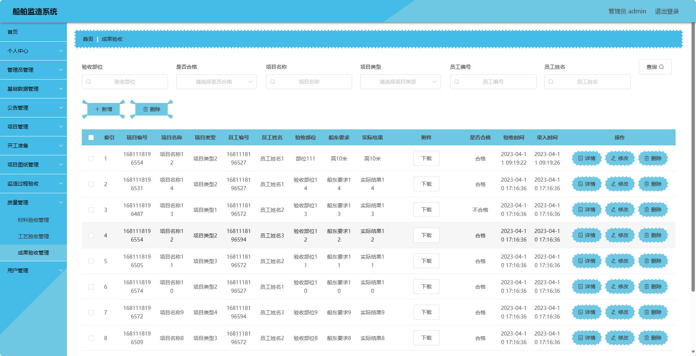
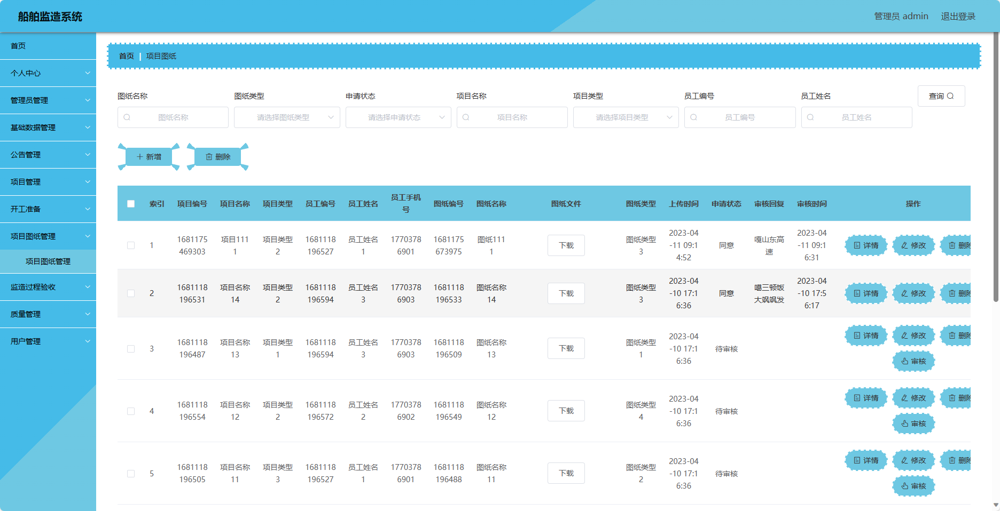

## ❓ 常见问题

**跑不起来？**
- 确认 JDK / Maven / MySQL 版本与运行必读一致；先能编译通过再启动。

**端口占用？**
- 修改 `server.port`，或关闭占用 8080 的进程。

**数据库连接失败？**
- 检查库名是否已创建、账号密码、时区与 `allowPublicKeyRetrieval` 等 JDBC 参数。

## 📚 更多开源项目

完整清单见仓库内 [`PROJECTS.md`](./PROJECTS.md)。

## 免责声明与许可

- 本仓库仅供学习交流，不包含商业授权。
- 源码来源于教学/毕设实践整理，使用风险自负。
- 转载请注明出处；请勿用于非法用途。
- 详见 [`LICENSE`](./LICENSE)。

---

**更多完整项目 → {SITE_URL}**
